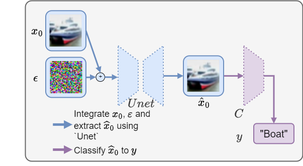

# ConsistencyPure: Consistency Models for Realtime Adversarial Purification

<p align="center">
  
</p>

ConsistencyPure defends a classifier by diffusing the input image to a small noise
level and mapping it back with a consistency model in one (or a few) network
evaluations. This repository evaluates the defense under adaptive white-box attacks
(PGD with Expectation over Transformation, backpropagating through the purifier):

- CIFAR-10/100 with a CIFAR-10 consistency model (`attack_eval.py`),
- ImageNet with Stable Diffusion v1.5 and LCM-LoRA (`attack_eval_imagenet_lcm.py`).

Training code for the CIFAR-10 consistency models:
https://github.com/LYMDLUT/improved_consistency_models_cifar10_pytorch

## Setup

```bash
pip install -r requirements.txt
```

`transformers` is only needed for the ViT classifier; `diffusers`, `peft` and `timm`
only for the ImageNet evaluation.

The NCSN++ network uses a custom CUDA kernel (`models/op`) that is compiled on first
use. If compilation fails, a slower pure PyTorch implementation is used instead; set
`UPFIRDN2D_BACKEND=native` to skip the compilation.

## Checkpoints

**Consistency model** (`--cm-ckpt`): NCSN++ weights in the layout of
[`configs/cifar10_ncsnpp.py`](configs/cifar10_ncsnpp.py), for example

- the official CT-LPIPS CIFAR-10 model of
  [openai/consistency_models_cifar10](https://github.com/openai/consistency_models_cifar10),
  converted from JAX to a PyTorch state dict (used for the results below; the
  conversion script is not part of this repository), or
- a checkpoint of the training repository above: `ema_*.pth` or `last.pt` (select the
  weights with `--cm-ckpt-key ema|model`).

**Classifiers** (`--classifier`, file given by `--classifier-ckpt`):

| Name       | Dataset   | Default file                                      | Format                                   | Input normalization |
|------------|-----------|---------------------------------------------------|------------------------------------------|---------------------|
| `t7`       | CIFAR-10  | `origin.t7`                                       | pickled `networks.wide_resnet` module in `{'net': model}` | CIFAR-10 mean/std |
| `cifar100` | CIFAR-100 | `wide-resnet-28x10-cifar100.t7`                   | same as `t7`                             | CIFAR-100 mean/std  |
| `kzcls`    | CIFAR-10  | `natural.pt`                                      | `networks.WRN.WideResNet` state dict in `{'state_dict': ...}` | none |
| `r18`      | CIFAR-10  | `lastpoint.pth.tar`                               | `networks.resnet.ResNet18` state dict    | none                |
| `vit`      | CIFAR-10  | `vit-base-patch16-224-in21k-finetuned-cifar10`    | Hugging Face model directory or hub id   | from its image processor config |

The `.t7` files contain whole pickled modules and are loaded with
`torch.load(weights_only=False)`, so only use trusted files.

## CIFAR evaluation

```bash
# One GPU
python attack_eval.py --cm-ckpt ckpt/ct_lpips.pth --classifier t7 --norm linf

# Four GPUs; --batch-size is per process
torchrun --nproc_per_node 4 attack_eval.py --cm-ckpt ckpt/ct_lpips.pth \
    --norm l2 --sigma-max 0.4 --purify-steps 2 --batch-size 32
```

Main options (see `python attack_eval.py --help`):

| Option | Default | Meaning |
|--------|---------|---------|
| `--sigma-max` | 0.5 | noise level the input is diffused to |
| `--purify-steps` | 1 | consistency steps; later steps use noise levels `(2σ + 0.002) / 3` |
| `--norm` | `linf` | `linf` or `l2` |
| `--eps`, `--alpha` | 8/255, 1/255 (Linf); 0.5, 0.1 (L2) | budget and step size in `[0, 1]` pixel scale; fractions such as `8/255` are accepted |
| `--pgd-steps`, `--eot-steps` | 20, 10 | attack iterations and gradient samples per iteration |
| `--num-test` | 1024 | first N test images |

Each run writes `log.txt` and `results.json` to `--output-dir` with four accuracies:

- `clean`: classifier on clean images, without purification,
- `purified_clean`: classifier on purified clean images,
- `adversarial`: classifier on the adversarial images, without purification,
- `robust`: classifier on purified adversarial images, i.e. the defended accuracy.

`scripts/sweep_noise_scale.sh` and `scripts/sweep_steps.sh` run the sweeps of the
results below (`CM_CKPT=... NUM_GPUS=4 scripts/sweep_noise_scale.sh`).

## ImageNet evaluation (Stable Diffusion + LCM-LoRA)

```bash
torchrun --nproc_per_node 4 attack_eval_imagenet_lcm.py --data-dir /path/to/imagenet/val
```

The validation set must be in ImageFolder layout (one folder per synset). The
defaults follow the original experiments: `stable-diffusion-v1-5` with
`latent-consistency/lcm-lora-sdv1-5`, strength 0.1 with 50 scheduler steps (5 LCM
steps) at 512x512, timm `resnet101`, Linf eps 4/255 with step 0.5/255, PGD-20 and
EOT-1. `--sd-model` and `--lcm-lora` also accept local paths. The images are a seeded
random subset of `--num-test` images (`--subset first` or `--subset-indices FILE` to
choose otherwise). `scripts/imagenet_lcm.sh` runs the settings of the results below.

## Results

Obtained with the original scripts:

- [CIFAR-10, accuracy against the noise level](results/cifar10_noise_scale.md)
- [CIFAR-10, accuracy against the number of purification steps](results/cifar10_steps.md)
- [ImageNet, Stable Diffusion + LCM-LoRA](results/imagenet_lcm.md)

## Changes from the original scripts

The attacks and the purification are numerically the same as before (the tests
compare them with the original code), but a few fixes change what is measured:

- Every one of the `--num-test` images is evaluated exactly once. Before, the last
  incomplete batch of each process was dropped and `DistributedSampler` padded the
  test set with duplicates, unless `--num-test` divided evenly into batches on every
  process (as in the CIFAR results: 1024 images, 4 GPUs, batch size 32).
- `purified_clean` is reported in every run; the original scripts only reported the
  accuracy without purification on clean images.
- `--classifier vit` normalizes its input as specified by the checkpoint's image
  processor; before it received unnormalized `[0, 1]` images.
- `--classifier kzcls` works (it failed with a `NameError`) and uses unnormalized
  inputs, as in the TRADES code its network comes from.
- ImageNet: a random subset instead of the first images (see above), and
  `--strength` and `--num-inference-steps` are honored (before, 0.1 and 50 were
  hard-coded). Batch sizes above 1 work.
- The scripts run under `torchrun`, and without a process group on a single GPU or
  CPU. Before, they required the deprecated `torch.distributed.launch` and used the
  local rank as the global rank, so multi-node runs evaluated duplicate shards.

## Repository layout

```
attack_eval.py              CIFAR-10/100 evaluation
attack_eval_imagenet_lcm.py ImageNet evaluation with Stable Diffusion + LCM-LoRA
attacks.py                  PGD-EOT (Linf and L2)
purification.py             consistency model purifier
lcm_purification.py         differentiable LCM img2img purifier
classifiers.py              CIFAR classifiers and their preprocessing
evaluation.py               attack/evaluation loop shared by both scripts
common.py                   distributed setup, logging, checkpoint helpers
configs/, models/           NCSN++ (from score_sde_pytorch)
networks/                   classifier architectures
scripts/                    experiment sweeps
results/                    reported results
```

## Development

```bash
pip install pytest ruff
pytest
ruff check . && ruff format --check .
```

## Acknowledgements

The NCSN++ implementation comes from
[score_sde_pytorch](https://github.com/yang-song/score_sde_pytorch), the consistency
model parameterization and the CT-LPIPS model from
[openai/consistency_models_cifar10](https://github.com/openai/consistency_models_cifar10),
and the LCM purification builds on
[diffusers](https://github.com/huggingface/diffusers) and
[LCM-LoRA](https://huggingface.co/latent-consistency/lcm-lora-sdv1-5).
